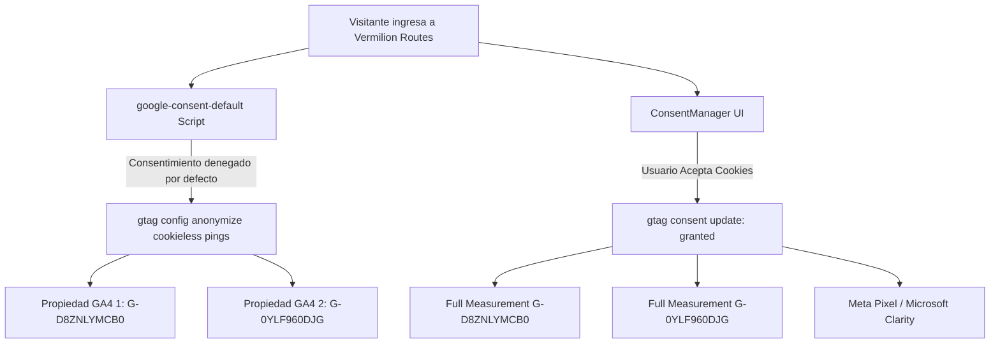

# 📊 06. Analítica Web, Dual Google Tag y Verificadores (SEO/GEO)

Este documento detalla la arquitectura de medición analítica, el sistema de **Dual Google Tag (gtag.js)**, la integración con **Google Consent Mode v2** y la gestión de múltiples verificadores en [[01_Auth|Vermilion Routes]].

---

## 🎯 Arquitectura de Dual Tagging (GA4)

El sitio soporta y distribuye eventos simultáneamente a múltiples propiedades de Google Analytics (GA4) y verificadores de Google Search Console sin degradar el rendimiento (TBT = 0ms) gracias a la carga diferida con `strategy="lazyOnload"`.

---

## ⚙️ Identificadores Configurados

| Parámetro | ID Configurado | Propósito |
| :--- | :--- | :--- |
| **GA4 Primario** | `G-D8ZNLYMCB0` | Propiedad corporativa principal de analítica |
| **GA4 Secundario** | `G-0YLF960DJG` | Segunda propiedad / Tag adicional del cliente |
| **Google Tag Manager** | `GTM-TDQXQ738` | Contenedor GTM opcional |
| **Google Site Verification** | `google-site-verification-vermilion` | Verificador de Google Search Console |

---

## 🛡️ Cumplimiento de Privacidad y Google Consent Mode v2

1. **Denegación por Defecto (`ad_storage: 'denied'`, `analytics_storage: 'denied'`):**
   - Al cargar la página, se declara el estado de consentimiento inicial.
   - Ambos IDs (`G-D8ZNLYMCB0` y `G-0YLF960DJG`) reciben `gtag('config')` inicial con `anonymize_ip: true`, permitiendo a los bots de verificación de Google (Tag Assistant) confirmar que las etiquetas están activas y recibiendo señales de modelado cookieless.
2. **Actualización Dinámica vía [[ConsentManager]]:**
   - Cuando el usuario hace clic en "Aceptar cookies", el componente actualiza el estado a `granted` y reconfigura ambos flujos de datos.

---

## 🚀 Despliegue en Vercel

¿Es necesario subir algo manualmente a Vercel?
- **No es obligatorio**: Ambos tags están configurados con valores de respaldo nativos en el código fuente.
- **Opcional en Vercel Dashboard**: Si se desea cambiar o agregar IDs en el futuro sin modificar el repositorio, se pueden definir las variables de entorno en Vercel:
  - `NEXT_PUBLIC_GA_ID`
  - `NEXT_PUBLIC_GA_SECONDARY_ID`
  - `NEXT_PUBLIC_GOOGLE_SITE_VERIFICATION`
  - `NEXT_PUBLIC_GOOGLE_SITE_VERIFICATION_SECONDARY`

Documentos relacionados:
- [[01_Auth]]
- [[05_Ecommerce]]
