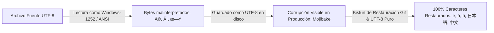

# 🌐 Saneamiento y Preservación de Codificación UTF-8 Multilingüe (i18n)

Documentación técnica del saneamiento de codificación de caracteres, tildes y glifos multilingües en Vermilion Routes.

---

## 🔍 Causa Raíz del Incidente (Mojibake UTF-8)

El problema de caracteres corruptos en producción (ej. `MéTODOS`, `Política`, `España`, `日本語`, `中文`) se originó en el commit `59991aa` debido a scripts `.cjs` ejecutados localmente en entorno Windows sin forzado estricto de codificación UTF-8 en sus streams I/O.
El entorno leyó los archivos UTF-8 nativos bajo la tabla de caracteres Windows-1252 (ANSI) y los reescribió como UTF-8, generando una doble codificación (mojibake).

---

## 🛡️ Archivos Afectados y Saneados

| Archivo | Afectación Previa | Estado Actual | Corrección Aplicada |
|---|---|---|---|
| [`components/layout/Footer.tsx`](file:///c:/Users/pablo/OneDrive/Desktop/proyectos%20web/vermilion/components/layout/Footer.tsx) | 143 secuencias mojibake en textos de pago, badges y selector de idioma | **100% Limpio (0 errores)** | Reemplazo con diccionario limpio, conservando enlaces a PDFs (`patente turismo.pdf`, `Ruc.pdf`) y enlace de TikTok `@vermilionroutes`. |
| [`data/mock.ts`](file:///c:/Users/pablo/OneDrive/Desktop/proyectos%20web/vermilion/data/mock.ts) | 2,946 tildes y caracteres corruptos en 23 tours | **100% Limpio (0 errores)** | Restauración al commit limpio (`1271ce8`), preservando la totalidad de descripciones e itinerarios de 8 idiomas sin BOM. |
| [`lib/ai-providers.ts`](file:///c:/Users/pablo/OneDrive/Desktop/proyectos%20web/vermilion/lib/ai-providers.ts) | 68 caracteres corruptos en prompts y respuestas de fallback | **100% Limpio (0 errores)** | Restauración al commit limpio (`1af152c`), preservando la instrucción crítica de forzado de idioma para el agente Pyro. |

---

## 🔒 Estándar de Prevención para Futuros Commits

1. **Codificación Universal:** Todo archivo `.ts`, `.tsx`, `.json`, `.md` debe guardarse estrictamente en **UTF-8 sin BOM (UTF-8 without BOM)**.
2. **Prohibición de Scripts ANSI:** Si se usan scripts Node.js para manipulaciones batch, es mandatorio declarar explícitamente `{ encoding: 'utf8' }` en `fs.readFileSync` y `fs.writeFileSync`.
3. **Escaneo Automático Pre-Push:** Ningún commit debe incluir secuencias típicas de mojibake (`é`, `á`, `ó`, `ñ`, `â€`, `©`).

---

## 🔗 Enlaces Relacionados
- [[01_Auth]] — Seguridad, roles de usuario y sesiones de Firebase.
- [[05_Ecommerce]] — Flujos de reserva y pasarelas de pago.
- [[06_Analytics_SEO]] — Medición dual de Google Analytics y SEO técnico.
