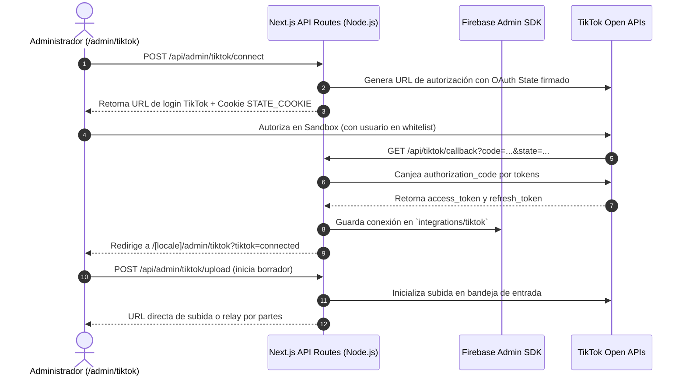

# 📱 Integración TikTok Developer (Login Kit + Content Posting API)

Este documento registra la arquitectura técnica, configuración de Sandbox, empaquetado de servidor y resiliencia de la integración con TikTok en **Vermilion Routes**.

---

## 🗺️ Arquitectura de la Integración

---

## 🔑 Configuración del Entorno Sandbox ("Pruebas")

- **App ID:** `7695706754587346951`
- **Client Key:** `sbawai89zpk0sbyr8h` (prefijo `sb` identifica entorno Sandbox)
- **Client Secret:** `xUFaaa0Zb6HyM0t5MYJ6oucNMvQmsFuE`
- **Redirect URI:** `https://www.vermilionroutes.com/api/tiktok/callback`
- **Alcances (Scopes):** `user.info.basic`, `video.upload`

### Campos obligatorios del formulario Sandbox en TikTok Developer Portal:
1. **Descripción de la aplicación (≤ 120 caracteres):**
   `Vermilion Routes: gestión y subida de videos y expediciones turísticas en Ecuador y Galápagos.`
2. **URL de Términos de Servicio:**
   `https://www.vermilionroutes.com/es/terms`
3. **URL de Política de Privacidad:**
   `https://www.vermilionroutes.com/es/privacy-policy`
4. **Usuarios Objetivo (Target Users / Whitelist):**
   En la sección *Configuración de Sandbox* -> *Usuarios objetivo*, agregar el `@usuario` de TikTok con el que se realizarán las pruebas.

---

## 🛡️ Resiliencia y Empaquetado Serverless (Vercel)

1. **`firebase-admin` en `dependencies`:**
   Movido de `devDependencies` a `dependencies` en `package.json` para garantizar que el SDK esté disponible en el runtime Serverless de Vercel.
2. **`serverExternalPackages` en `next.config.mjs`:**
   Configurado `serverExternalPackages: ['firebase-admin']` para evitar conflictos de empaquetado nativo con Turbopack/Webpack.
3. **Unificación de SDKs de Firebase Admin:**
   `lib/firebase-admin.ts` reexporta directamente desde `lib/firebaseAdmin.ts`, garantizando un único punto de verdad compatible con `FIREBASE_SERVICE_ACCOUNT_JSON`.
4. **Runtime Node.js Forzado:**
   Todos los endpoints de la API de TikTok declaran explícitamente `export const runtime = 'nodejs';` y `export const dynamic = 'force-dynamic';`.
5. **Cero Caídas por Estado Inicial (Fail-Safe):**
   El endpoint `/api/admin/tiktok` captura cualquier excepción de consulta y responde con código 200 `{ configured, connected: false }`, permitiendo que la interfaz de usuario cargue limpiamente el botón de conexión.
