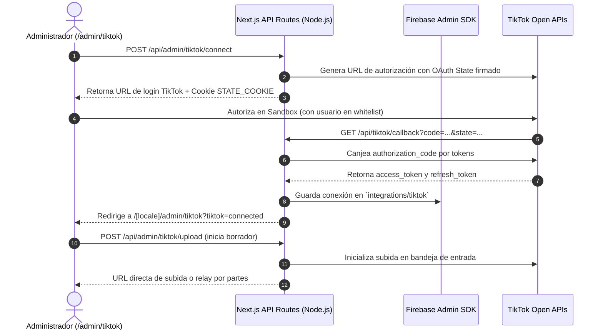

# 📱 Integración TikTok Developer (Login Kit + Content Posting API)

Este documento registra la arquitectura técnica, configuración de Sandbox, empaquetado de servidor y resiliencia de la integración con TikTok en **Vermilion Routes**.

---

## 🗺️ Arquitectura de la Integración

---

## 🔑 Configuración del Entorno Sandbox ("Pruebas")

- **App ID:** `7695706754587346951`
- **Client Key:** `sbawai89zpk0sbyr8h` (prefijo `sb` identifica entorno Sandbox)
- **Client Secret:** guardado solo en la variable de entorno `TIKTOK_CLIENT_SECRET` (Vercel y `.env` local). Nunca se escribe en este repositorio, que es publico.
- **Redirect URI:** `https://www.vermilionroutes.com/api/tiktok/callback`
- **Alcances (Scopes):** `user.info.basic`, `video.upload`, `video.publish` (este último debe estar activado en el Developer Portal antes de conectar; si no, TikTok rechaza la autorización)

### Campos obligatorios del formulario Sandbox en TikTok Developer Portal:
1. **Descripción de la aplicación (≤ 120 caracteres):**
   `Vermilion Routes: gestión y subida de videos y expediciones turísticas en Ecuador y Galápagos.`
2. **URL de Términos de Servicio:**
   `https://www.vermilionroutes.com/es/terms`
3. **URL de Política de Privacidad:**
   `https://www.vermilionroutes.com/es/privacy-policy`
4. **Usuarios Objetivo (Target Users / Whitelist):**
   En la sección *Configuración de Sandbox* -> *Usuarios objetivo*, agregar el `@usuario` de TikTok con el que se realizarán las pruebas.

---

## 🛡️ Resiliencia y Empaquetado Serverless (Vercel)

1. **`firebase-admin` en `dependencies`:**
   Movido de `devDependencies` a `dependencies` en `package.json` para garantizar que el SDK esté disponible en el runtime Serverless de Vercel.
2. **`serverExternalPackages` en `next.config.mjs`:**
   Configurado `serverExternalPackages: ['firebase-admin']` para evitar conflictos de empaquetado nativo con Turbopack/Webpack.
3. **Unificación de SDKs de Firebase Admin:**
   `lib/firebase-admin.ts` reexporta directamente desde `lib/firebaseAdmin.ts`, garantizando un único punto de verdad compatible con `FIREBASE_SERVICE_ACCOUNT_JSON`.
4. **Runtime Node.js Forzado:**
   Todos los endpoints de la API de TikTok declaran explícitamente `export const runtime = 'nodejs';` y `export const dynamic = 'force-dynamic';`.
5. **Cero Caídas por Estado Inicial (Fail-Safe):**
   El endpoint `/api/admin/tiktok` captura cualquier excepción de consulta y responde con código 200 `{ configured, connected: false }`, permitiendo que la interfaz de usuario cargue limpiamente el botón de conexión.

---

## 🚀 Publicación Directa (scope `video.publish`) y salida de Sandbox

### Qué existe en código (`lib/tiktok.ts`)
- `initDirectPostFile(token, size, opts)`: `POST /v2/post/publish/video/init/` con `source: FILE_UPLOAD`. Devuelve `uploadUrl` para subir las partes con `putChunk`.
- `initDirectPostFromUrl(token, videoUrl, opts)`: misma ruta con `source: PULL_FROM_URL` (la URL debe estar en un dominio verificado en TikTok).
- `fetchPublishStatus(token, publishId)`: consulta de estado para ambos flujos. Estados finales: `isTerminalPublishStatus()` (`PUBLISH_COMPLETE`, `SEND_TO_USER_INBOX`, `FAILED`).
- Guardia: si `privacyLevel` no es `SELF_ONLY` y `appAudited` no es `true`, la función lanza `privacy_requires_audit` antes de llamar a TikTok.
- Flujo bandeja (`initInboxUpload`, `video.upload`) sin cambios.

### Estado actual
- Solo está escrito el código. **No se ha llamado al endpoint de publicación con videos reales** y no hay rutas `/api` nuevas que lo usen.
- Las variables que lee el código siguen siendo `TIKTOK_CLIENT_KEY` y `TIKTOK_CLIENT_SECRET`. No se añadió ninguna variable nueva.

### Requisitos reales para publicar de verdad
1. **Activar `video.publish`** en el Developer Portal (Products / Content Posting API). Sin esto, la autorización con ese scope falla.
2. **Auditoría de la app.** TikTok revisa la app antes de permitir publicación pública. Mientras la app no esté aprobada, todo video publicado por API queda **solo en privado** (`SELF_ONLY`). El código lo fuerza: sin `appAudited: true`, cualquier otra privacidad se rechaza.
3. **Permiso `video.publish` aprobado** por TikTok tras la auditoría. Solo con eso se puede usar `PUBLIC_TO_EVERYONE` y demás niveles.
4. **Reconectar la cuenta** después del cambio de scopes. Las conexiones guardadas en `integrations/tiktok` tienen el scope anterior y no lo incluyen.
5. Para `PULL_FROM_URL`: verificar el dominio de origen de los videos en el Developer Portal.
6. Salir de Sandbox implica un cambio de credenciales a las de producción. Las de producción están en `.env` como `TIKTOK_PRODUCTION_*` y el cambio a `TIKTOK_CLIENT_*` lo hace el dueño en Vercel, según la regla del proyecto.

### Sin aprobación
Solo se puede publicar en privado (`SELF_ONLY`). Cualquier intento con otra privacidad falla con `privacy_requires_audit` en el código, o con un error de TikTok si se saltara la guardia.
